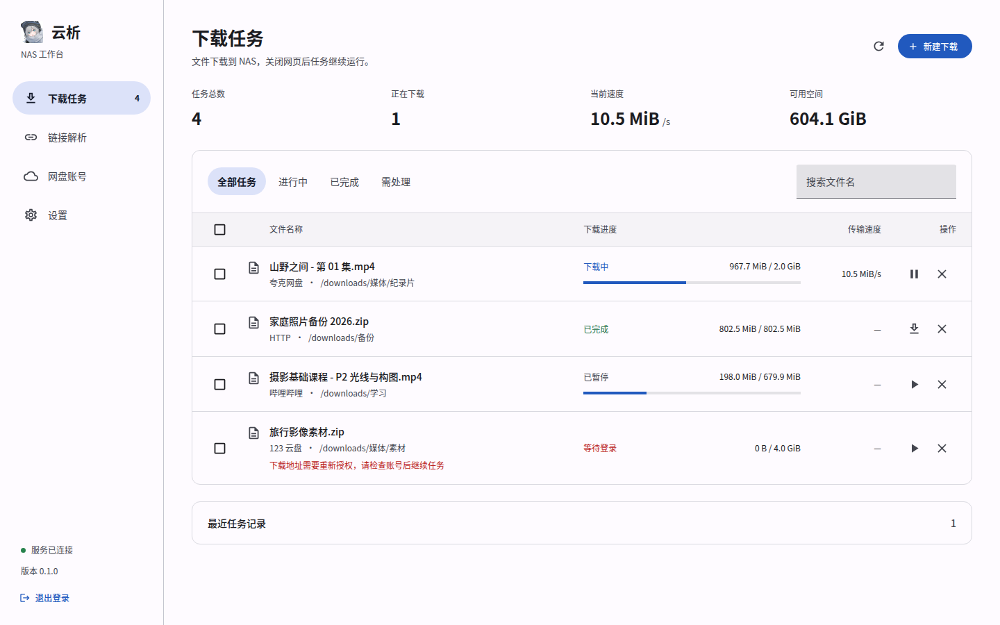
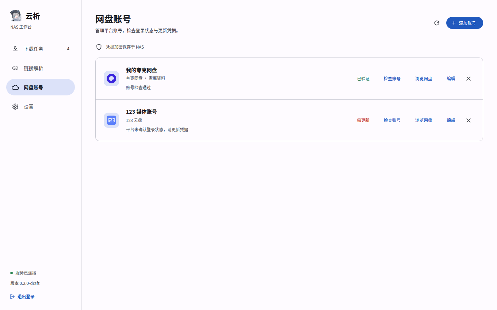
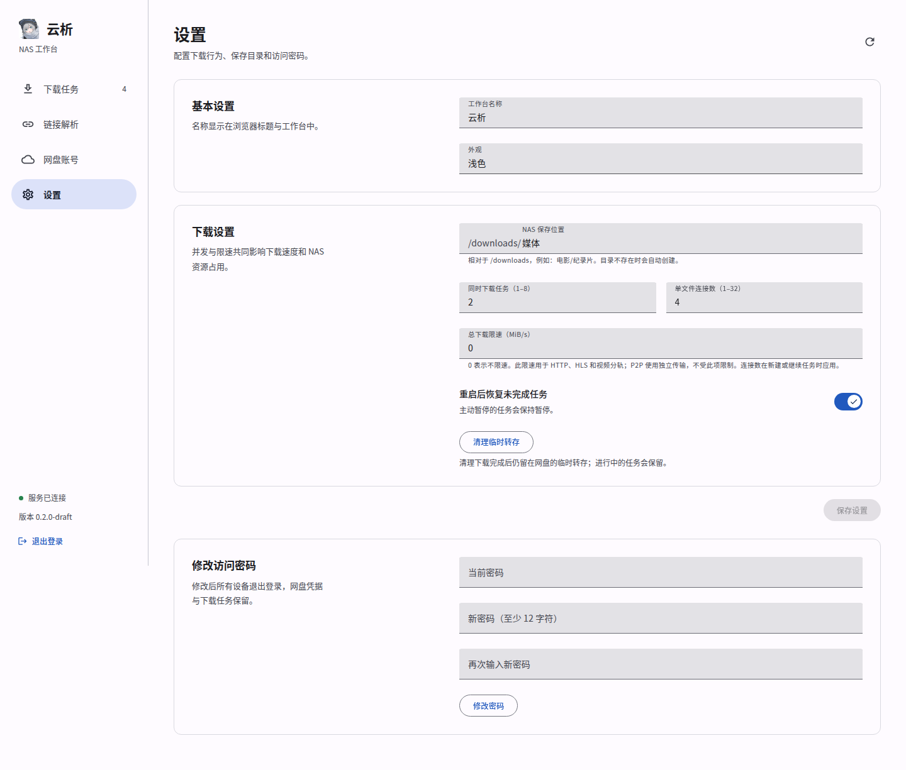
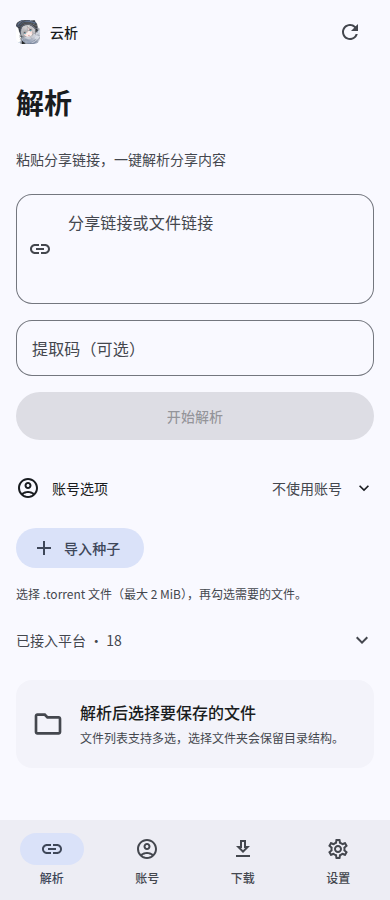

<div align="center">


# 云析服务端 · YunX-Server

**粘贴链接，在 NAS 上下载 —— 面向个人和家庭 NAS 的服务端与网页工作台**

10 类网盘、7 个视频与图集平台、GitHub；HTTP / HTTPS、HLS、DASH、磁力 / BT / ed2k。
服务端执行下载，手机和电脑通过浏览器管理，关闭网页后任务继续运行。

[](https://github.com/xiatian410/YunX-Server/stargazers)
[](LICENSE)
[](#构建)
[](https://go.dev/)
[](https://vuejs.org/)
[](https://www.mdui.org/)

[部署](#部署) · [功能](#功能) · [支持平台](#支持平台) · [使用](#使用) · [构建](#构建) · [常见问题](#常见问题) · [参考项目](#参考项目与致谢)

</div>

---

> **云析使用AGPL-3.0开源协议** 如果你使用了云析的代码，未经授权请遵守协议，同样以AGPL-3.0开放源代码

> 本项目同样采用 **AGPL-3.0**，参考 [CYQawa/YunX](https://github.com/CYQawa/YunX) 与 [tidain/YunX-Desktop](https://github.com/tidain/YunX-Desktop) 为 NAS 重写服务端和网页，复用原项目平台网络代码及图标。本项目为非官方 NAS 衍生版本。

> **当前为开发初稿。** 常规功能测试通过，但 Gopeed 1.9.3 的并发检测发现数据竞争；Linux amd64 容器构建及只读启动已通过 CI，真实平台账号与实体 NAS 尚未验证。请先阅读 [验证记录](docs/validation.md)，不要将本版视为生产稳定版。

## 简介

面向个人和家庭 NAS 的链接解析与下载工作台。服务端执行下载，浏览器关闭后任务继续运行。Go + SQLite + Gopeed；原版 Kotlin 网络代码运行在 Java 17 无界面模块中，通过私有进程通道接入；Vue 3 + TypeScript + MDUI 2。FFmpeg 处理 HLS、DASH 和动态照片，Chromium 仅在抖音页面解析需要时按需启动。

## 截图

以下为 0.2.0-draft 定稿 A 的实际网页截图，任务、账号和容量使用测试数据。链接解析与 18 平台入口见[解析页截图](docs/design/preview-resolve.png)。

| 下载任务 | 网盘账号 |
| :---: | :---: |
|  |  |

| 设置 | 手机端 |
| :---: | :---: |
|  |  |

## 功能

- **链接解析**：粘贴分享或视频链接、输入提取码、浏览目录、选择文件或整个文件夹入队。
- **下载管理**：HTTP / HLS / DASH / BT / ed2k 下载、队列、暂停 / 继续 / 取消、批量操作、重启恢复、SSE 进度推送。
- **账号管理**：单管理员登录与改密、多平台多账号、凭据加密保存、检查平台登录状态。
- **NAS 保存**：配置下载目录、并发任务、每任务 HTTP 连接数与 HTTP/HLS 总限速；Bilibili 双轨、HLS 与动态照片自动整理，BT 可选择种子内文件。P2P 暂不使用 HTTP 限速设置。
- **文件与记录**：查看任务事件、预览已完成图片/音频/视频、将文件或 BT 目录 ZIP 下载到当前设备；删除记录默认保留最终文件，删除文件需要明确勾选确认。
- **网页界面**：MDUI 2 组件、浅色 / 深色 / 跟随系统，桌面侧栏和手机导航。

## 支持平台

| 来源 | 解析与目录 | 下载 |
| --- | --- | --- |
| 夸克、UC | 分享、提取码、个人网盘、目录分页 | 游客 / 登录态取链；按平台需要转存 |
| 123 云盘 | 分享、个人网盘、游标分页 | 分享直链与 Token 取链 |
| 百度、迅雷、139、115 | 分享、提取码、个人网盘、目录 | 原版 API 取链 / 转存；凭据要求按平台处理 |
| 光鸭、蓝奏云、蓝奏云优享版 | 分享、个人网盘与目录 | 原版分享 / 登录取链 |
| 哔哩哔哩 | BV / av、短链、分 P、清晰度 | 单文件 / DASH 双轨 |
| 抖音、小红书、快手、微博 | 视频 / 图集 | 平台直链；抖音按需浏览器解析；动态照片保留视频 |
| AcFun、Pixiv | 视频 / 作品图集 | AcFun HLS；Pixiv 多图 |
| GitHub | 用户 / 仓库 / 目录 / 文件 / Releases | 源码归档、文件、Release 附件；支持 PAT 私有仓库 |
| HTTP / HTTPS / HLS | 文件 / 点播列表 | 分段续传；HLS 最高码率、AES-128、初始化片段和本地合并 |
| 磁力 / .torrent / ed2k | 元数据、文件选择 / 文件链接 | Gopeed P2P；BT 选择文件并保留相对目录 |

这里的“支持”指解析、取链和执行路径已移植。平台识别、协议夹具和本地端到端测试与真实账号验收分别记录在 [平台移植表](docs/platform-parity.md) 和 [验证记录](docs/validation.md)。没有真实账号测试结果的项目不标为“实测可用”。平台更新、登录、会员权限、地区与风控仍可能影响实际结果。

NAS 账号入口采用手动 Cookie / Token，并提供迅雷设备 ID / 验证令牌、蓝奏优享 UUID / 用户 ID、光鸭设备 ID / 签名字段；不在 NAS 网页中嵌入原生登录窗口或绕过验证码。预览已完成的本地媒体；持续直播、DRM、平台上传、媒体库整理及桌面系统集成不属于本次平台下载移植。

## 部署

### NAS / Docker Compose

先获取源码：

```sh
git clone https://github.com/xiatian410/YunX-Server.git
cd YunX-Server
```

1. 复制 `.env.example` 为 `.env`，填写 NAS 用户的 UID/GID 与可写的 `DATA_DIR` / `DOWNLOAD_DIR`。数据目录和下载目录必须预先存在，且该 UID/GID 有写权限。程序不修改共享目录的拥有者。
2. 执行 `docker compose up -d --build`。
3. 浏览器访问 `http://NAS-IP:8080`。用户名 `admin`，初始密码在数据目录的 `initial-password.txt` 中；首次登录后可在设置中改密。

```sh
cp .env.example .env
mkdir -p data downloads
# 在 .env 中填写目录已有拥有者的 UID/GID，再启动
id -u
id -g
docker compose up -d --build
docker compose logs --tail=50 yunx
```

可由 `docker buildx build --platform linux/amd64,linux/arm64 ...` 构建两种架构。运行镜像包含 Java 17、Node 22、Chromium 和 FFmpeg。Compose 内存上限为 1536 MiB、临时目录 256 MiB；解析模块 JVM 堆上限 192 MiB，Chromium 同时至多一个实例。默认非 root、无额外 capabilities、只读根文件系统，写入仅在 `/data`、`/downloads` 和 `/tmp`。

反向代理访问时将 `PUBLIC_URL` 设置为浏览器访问的源，例如 `https://yunx.example.com`；保留原 Host，允许 SSE 长连接并关闭该路由缓冲。不自动信任转发 IP。凭据仅通过你自己的平台账号获取，平台验证或权限不足会明确显示，程序不跳过平台验证。

### 二进制运行

运行环境：Linux amd64 / arm64、Java 17、Node 22、Chromium 和 FFmpeg。`make build` 生成包含 Go 二进制、解析 JAR 与浏览器 worker 的 `release/` 目录；请保留整个目录。网页已嵌入二进制，不依赖在线 CDN。

```sh
YUNX_DATA_DIR=./data YUNX_DOWNLOAD_DIR=./downloads ./release/yunx-server
```

当前仓库提供源码与构建文件，未发布预编译 Release 或容器镜像。

## 使用

1. 以 `admin` 登录，在“设置”中修改初始密码并确认保存目录。
2. 需要登录的平台，在“网盘账号”添加自己的 Cookie / Token，按平台补充设备字段并检查账号状态；没有独立校验接口的平台会明确标为“未检查”，通过实际解析确认。
3. 在“链接解析”粘贴分享链接或视频地址，按需填写提取码并选择账号；也可从账号页浏览个人网盘；BT 使用“导入种子”，磁力和 ed2k 可直接粘贴。
4. 选择文件或文件夹，确认目标子目录并加入队列，在“下载任务”查看进度或暂停、继续。
5. 下载完成后，文件保存在 NAS 下载目录，也可在任务列表点击媒体文件名预览或下载到当前设备。视频解析提供清晰度时，入队前可切换；已排队任务的清晰度保持不变。设置中的“清理临时转存”用于手动重试未成功的清理。

## 技术栈

| 部分 | 技术 |
| --- | --- |
| 服务端 | Go、SQLite、AES-256-GCM、同源 HTTP API / SSE |
| 平台解析 | Kotlin 2.2.21 / Java 17；OkHttp；Chromium + Playwright Core |
| 下载与合轨 | Gopeed 1.9.3（HTTP / BT / ed2k）、FFmpeg、Motion Photo |
| 网页 | Vue 3、TypeScript、Vite、MDUI 2 / Material Icons |
| 部署 | Docker Compose、Linux amd64 / arm64、嵌入网页资源 |
| 验证 | Go 测试、Playwright、二进制冒烟、界面冻结哈希 |

## 构建

已验证的工具链为 Go 1.26.8、Node 22.22.1、Java 17、Gradle 8.14（wrapper）；依赖版本以锁文件为准：

```sh
make build
./release/yunx-server
```

前端开发：保持服务端在 `127.0.0.1:8080`，执行 `npm --prefix web run dev`。Go API 与发布网页来自同一源；Vite 开发代理保留 Host 以通过来源检查。修改网页后必须重新 build，再编译嵌入二进制。

## 配置与数据

| 环境变量 | 默认值 | 含义 |
| --- | --- | --- |
| `YUNX_ADDR` | `:8080` | HTTP 监听地址 |
| `YUNX_DATA_DIR` | `data` | SQLite、加密密钥、首次密码 |
| `YUNX_DOWNLOAD_DIR` | `downloads` | 下载根目录 |
| `YUNX_ADMIN_PASSWORD` | 自动生成 | 仅第一次初始化使用，至少 12 字节 |
| `YUNX_PUBLIC_URL` | 空 | 反向代理的浏览器访问源 |
| `YUNX_ALLOW_PRIVATE_DOWNLOADS` | `false` | 显式允许可信内网下载源 |
| `YUNX_PROVIDER_JAR` | 源码目录或二进制旁的 provider JAR | 全平台解析模块；缺失时明确拒绝启动 |
| `YUNX_BROWSER_SCRIPT` | provider/browser.mjs | Chromium worker 路径 |
| `YUNX_CHROMIUM` | 自动查找 chromium / google-chrome | 浏览器可执行文件 |
| `YUNX_WEB_DIR` | 空 | 开发时覆盖嵌入网页目录 |

应用账号、解析信息与任务状态使用 AES-256-GCM 加密存入 SQLite；平台凭据不回显。密钥文件 `credential.key` 必须与数据库一起备份。缺失密钥时拒绝启动，不会生成新密钥覆盖旧数据。备份前停止服务，再备份整个数据目录及下载目录 `.yunx` 分片；恢复时使用同一组目录。

续传会重新获取媒体地址并核对长度、ETag / Last-Modified。HTTP 源没有可靠标识或源文件已变化时保留分片并停止续传，避免拼接不同文件。手动暂停在重启后保持暂停；其余未完成任务按“重启后恢复”设置处理。登录会话不跨进程保存。

当前文件名含路径分隔符或超过 220 字节时拒绝入队；首版尚无重命名入口。任务最多 10,000 条；每批 1,000 文件、文件夹递归 20 层、网页分页最多 200 页，原版适配器也保留各自分页上限。种子最大 2 MiB / 1000 文件；磁力元数据至多 45 秒、一次仅解析一个；HLS 最多 10000 个资源、5 层列表。API 查询有 25–90 秒超时；HTTP 重定向最多 5 次；120 秒没有下载进展则停止引擎并等待手动继续。网页使用 SSE，断线后提示手动重连，不增加后台轮询。退出/关机等待引擎检查点至多 8 秒，合轨至多 10 分钟。

## 验证

```sh
make frontend provider
CGO_ENABLED=0 go test ./... -count=1
CGO_ENABLED=0 go vet ./...
# Playwright 自动编译并启动临时隔离实例，退出后清理自己的临时目录
npm --prefix web test
python3 scripts/check-freeze.py
```

浏览器测试需要 Linux Google Chrome（当前配置路径为 `/usr/bin/google-chrome`），默认自动启动临时隔离实例并操作测试账号、设置与下载。若显式指定 `YUNX_TEST_URL`，只能指向可清理的测试实例；外部实例使用 test-password-123 作为测试密码，并允许内网 fixture 下载。

功能、协议夹具、浏览器、双架构编译、Docker 构建与真实 NAS/平台账号验证的结果分别记录在 `docs/validation.md`。前端定点精修与冻结记录在 `docs/design/`。

## 常见问题

**关闭网页会停止下载吗？**

不会。下载由 NAS 服务进程执行；关闭服务或重启后，按设置恢复未完成任务，手动暂停的任务保持暂停。

**原版的平台是否都移植了？**

本版已接入原版 10 类网盘和 7 个视频/图集平台，并增加 GitHub 解析、磁力/BT/ed2k 执行。原版网络模块随服务一起运行，网页只负责操作。平台登录窗口改用凭据输入，账号、目录、链接和错误结果都经过服务端处理；逐项测试证据见平台移植表。

**Cookie / Token 会在哪里保存？**

凭据加密存入 NAS 数据目录，网页不回显。备份时必须同时保留数据库和 `credential.key`；详见上方“配置与数据”。

**为什么下载或续传失败？**

先检查任务错误和账号状态。平台授权不足、文件变化、无法核对源文件、长时间无进展都会停止任务并说明原因；服务不会绕过平台验证。先修正对应原因，再手动继续。

**如何反馈问题？**

在 [Issues](https://github.com/xiatian410/YunX-Server/issues) 提供版本、NAS 架构、操作步骤和已去除凭据的错误信息。不要上传 Cookie、Token、密钥或完整数据目录。

## 参考项目与致谢

| 项目 | 本项目中的用途 | 协议 |
| --- | --- | --- |
| [CYQawa/YunX](https://github.com/CYQawa/YunX) | Android 原项目；平台协议、签名与图标来源，README 格式参考 | AGPL-3.0 |
| [tidain/YunX-Desktop](https://github.com/tidain/YunX-Desktop) | 无界面模块的平台网络代码来源；Motion Photo 格式及下载流程、README 格式参考 | AGPL-3.0 |
| [GopeedLab/gopeed](https://github.com/GopeedLab/gopeed) | 下载执行引擎 | GPL-3.0 |
| [zdhxiong/mdui](https://github.com/zdhxiong/mdui) | 网页组件与操作图标 | MIT |
| [vuejs/core](https://github.com/vuejs/core) | 网页框架 | MIT |

感谢原作者及贡献者。参考提交、图标逐文件来源和依赖说明见 [NOTICE.md](NOTICE.md) 与 [图标来源](docs/icon-sources.md)。

## 文档

- [实现计划](docs/implementation-plan.md) / [架构](docs/architecture.md)
- [平台移植与验收](docs/platform-parity.md)
- [功能与验证结果](docs/validation.md)
- [界面规范与冻结](DESIGN.md) / [本次图标增量](docs/design/increments/2026-11-03-original-icons.md)

## 开源协议

本项目采用 **GNU Affero General Public License v3.0（AGPL-3.0）**，完整条款见 [LICENSE](LICENSE)。使用、修改或分发本项目时请保留原作者与许可声明，并遵守相应的源码提供义务；通过网络提供修改版服务时，应向交互用户提供对应源代码。

源代码：[xiatian410/YunX-Server](https://github.com/xiatian410/YunX-Server)。本项目未部署到你的 NAS。
