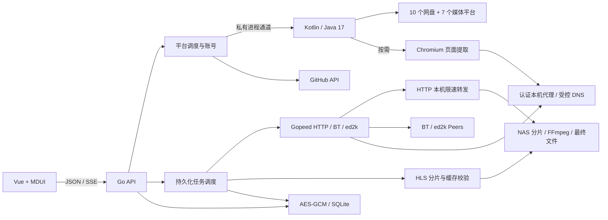

# 服务端与网页

- `provider/`：原版纯网络代码和仓库模块；逐请求凭据隔离。原生桌面窗口改为 NAS 接口与手动凭据输入。启动失败会明确拒绝服务启动，避免把缺失模块当成完整支持。`YUNX_PROVIDER_JAR=disabled` 仅用于精简调试，此时注册表只显示原生实现的 5 个平台。
- `provider_process.go` / `provider_bridge.go`：Go 私有管道、最多 4 个模块请求、90 秒调用期限；分享会话、平台分页与清晰度。解析结果只向浏览器返回文件公开字段，链接和凭据不会透传。
- `provider_github.go`：用户/仓库/目录/Releases、PAT 与私有仓库；文件下载继续经过统一网络边界。
- `engine.go`：队列、暂停/继续/取消、重启恢复、事件快照、HTTP 续传校验与双轨合并。HTTP 引擎只接触认证本机转发地址。网页仅显示服务端状态。
- `hls.go` / `motion_photo.go`：点播 HLS 列表、AES-128、分片缓存与内容变化校验；FFmpeg 只读取下载后的本地片段。动态照片保留静图与视频。
- `p2p.go`：磁力元数据期限、种子大小/路径检查、文件选择、持久化、完成后停止做种、原子发布、目录 ZIP。P2P HTTP tracker / webseed 走受控代理；peer/UDP 协议由 Gopeed / anacrolix 执行。HTTP 限速不作用于 P2P。单个代理连接有 10 分钟上限。
- `network.go` / `browser_proxy.go`：HTTP(S) DNS 检查与连接；默认拒绝内网，跨主机重定向移除凭据。Chromium 代理仅允许 HTTP/HTTPS，连接期限 50 秒；没有暴露开放代理。
- `provider_cleanup.go`：保存未清理的转存记录；只清理本次任务的临时对象，不清空账号目录。百度只删除本次转存文件，保留共享临时目录，防止影响并发任务。
- `http.go` / `provider_ui.go`：管理员会话、登录限流、来源校验、上传种子、清晰度、额外凭据、手动清理与本地媒体预览。
- `store.go`：SQLite WAL，敏感记录 AES-256-GCM；数据库与密钥一起备份。
- `web/src/App.vue`：四路由保留，MDUI 自定义元素按 value/checked 属性与事件对接。弹窗关闭事件用 `.self` 过滤内部下拉事件；较晚返回的状态请求不能覆盖已收到的 SSE 更新。
- `web/scripts/design-*.mjs` 只用于截图测量，测试数据不会进入生产页面。

## MDUI MCP

本机 Codex 已配置 `mdui` MCP（stdio `npx -y @mdui/mcp`）。初稿阶段通过 stdio JSON-RPC 获取 MDUI 2 组件元数据，使用 2.1.5。官方说明：https://www.mdui.org/zh-cn/docs/2/ai/mcp 。Vue 将 `mdui-*` 声明为 custom elements。

## 验证边界

源代码测试、真实媒体/种子本地夹具、浏览器、双架构二进制和容器检查分开记录。真实平台账号、平台风控、公开 P2P 网络、实体 NAS 与长时间稳定性不由夹具替代。Gopeed 1.9.3 已知 race 检测问题仍见 `validation.md`。
