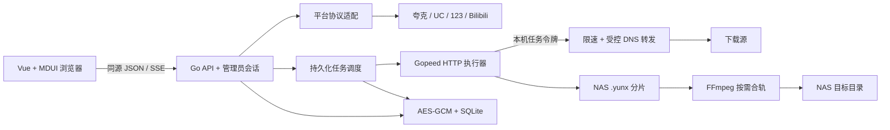

# 服务端与网页

- `internal/server/providers.go`：依据原项目调用链实现平台分支；JSON 数字使用 Number 保留 123 文件 ID 精度；异常响应不映射为空目录。
- `internal/server/engine.go`：任务状态机、调度、Gopeed 事件快照、本机转发、目录与恢复校验、FFmpeg。引擎只接触本机转发 URL，平台 Cookie/Token 留在服务端加密记录中。
- `internal/server/network.go`：仅 HTTP/HTTPS；受控解析后直接连接选定 IP；默认拒绝私网目标；跨域跳转不转发 Cookie / Authorization。
- `internal/server/http.go`：管理员会话、登录限流、来源校验、API、SSE 和嵌入网页。每次账号编辑留空凭据保留已有值；账号检查失败保留凭据。
- `internal/server/store.go`：SQLite WAL；敏感记录使用独立密钥加密，数据库与密钥必须成套备份。
- `web/src/App.vue`：四个工作页面；MDUI 自定义元素通过 value/checked 属性及事件对接 Vue；实际按钮标签通过组件更新完成后写入原生控件。
- `web/scripts/design-fixture.mjs` 仅为浏览器测量提供确定数据，不被生产构建导入。

## MDUI MCP

本机 Codex 已配置 `mdui` MCP（stdio `npx -y @mdui/mcp`）。本会话通过 stdio JSON-RPC 握手与工具查询获取 MDUI 2 组件元数据，版本为 2.1.5；当前会话的动态工具目录不会因为修改配置自动增加工具，后续新会话可直接加载。

官方说明：https://www.mdui.org/zh-cn/docs/2/ai/mcp 。前端使用 MDUI Vue 官方接入方式，将 `mdui-*` 声明为 custom elements，未对组件使用原生 v-model 假设。

## 已知边界

Gopeed 内部 race 报告未修复，见 validation.md。平台账号和真实分享链接尚未验证；这是功能初稿，不是生产稳定性承诺。NAS 目录并发修改、存储故障、真实平台限流与长时间运行仍需实体环境验收。
